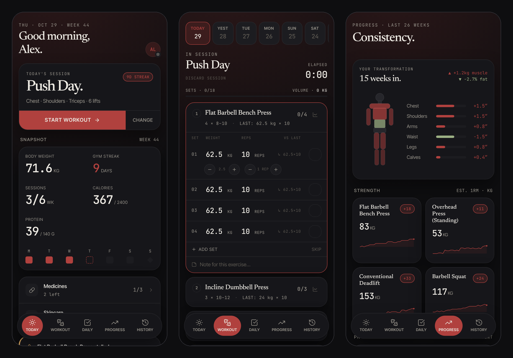

# Upkeep



A personal tracker for training, food, sleep, medicines and skincare. It's an installable web app
that works offline: everything is saved in the browser, with no account. Signing in backs it up
and syncs it across your devices, through your own Supabase project.

Live at [upkeep.dhanpulse.in](https://upkeep.dhanpulse.in). It works there without an
account; sign-in on that copy is only for its owner. Built with React, TypeScript, Tailwind CSS
and [Supabase](https://supabase.com).

## Features

- **Workouts**: a push, pull and legs week, where you choose each day's lifts and can swap any
  day. Log sets with steppers, for weighted, bodyweight and timed lifts. Last session's numbers
  come prefilled, double progression says when to add weight, and stalled lifts and PRs are
  flagged
- **Progress**: a 26-week consistency heatmap, body measurements over time, estimated one-rep max
  per lift, PRs and the balance between muscle groups
- **Food**: calories and macros against targets you set, from a library of common Indian foods and
  your own, in servings such as "1 bowl"
- **Sleep**: phone away, in bed and awake, and how rested you felt
- **Medicines and skincare**: daily, weekly, every few days or as needed; morning and night
  routines; how often you kept to them
- **Your data**: backup and restore (merge or replace), JSON and CSV export, and a weekly summary in
  Markdown for a coach or an AI
- **Sync (optional)**: sign in with a 6-digit code by email. Changes from each device merge item
  by item, so nothing is overwritten unseen

## Quick start

```bash
npm install
npm run dev
```

That's the whole app, offline. For sign-in and sync, copy `.env.example` to `.env` and fill in
your Supabase project's URL and publishable key. [docs/self-hosting.md](docs/self-hosting.md)
walks through the project and deploying on Vercel.

## Tests

```bash
npm test         # unit tests (Vitest): sync, merging, migrations, nutrition, onboarding
npm run build    # type-checks, then builds the app into dist/
```

## Layout

```
src/
  routes/       screens: today, workout, daily, progress, history, settings, onboarding
  components/   shared pieces: navigation, food, medicines, skincare, sync, charts
  lib/          storage, sync and merging, data migrations, nutrition, progression, export
supabase/       config, migrations for the sync table, the sign-in email
scripts/        generates the app icons
docs/           self-hosting and architecture
```

[docs/architecture.md](docs/architecture.md) explains storage, sync and sign-in.

## Contributing and security

See [CONTRIBUTING.md](CONTRIBUTING.md). Please report security problems privately, as
[SECURITY.md](SECURITY.md) describes.

## License

[AGPL-3.0](LICENSE). You can use, change and host Upkeep. If you let others use a changed version
over a network, share your changes under the same license.
